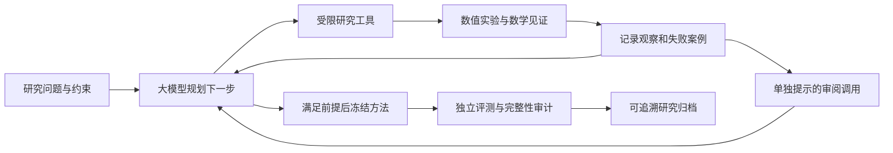

# CrowdLocateLab

### 面向异步众包定位的数学科研智能体

[](https://github.com/orgyuanbao/CrowdLocateLab/actions/workflows/tests.yml) · [中文研究报告](report/CrowdLocateLab_Report.pdf) · [研究证据卡片](archives/revision_reference/index.html) · [快速开始](START_HERE.md)

**学生：徐楷沅　｜　学号：2352163　｜　GitHub：[orgyuanbao](https://github.com/orgyuanbao)**

CrowdLocateLab 让大模型提出可检验的定位假设，调用数值工具进行实验，根据失败案例修订方法，再冻结配置并使用独立数据评估。研究过程保留真实模型响应、工具结果和失败记录，可以沿着证据检查每次决策。

本项目来自《HarmonyOS 难题发布》第七期的众包离线位置聚合难题。我们研究其中的**合成数学子问题**：接收点在不同时刻给出带噪声、含异常值的距离观测时，如何估计目标当前的位置，并判断何时不应信任结果。尚无工业现场验证，不宣称解决完整原题或发明通用新定位算法。

## 先看什么

| 你想做的事 | 入口 | 是否调用模型 |
| --- | --- | --- |
| 看选题、方法和两轮结果 | [52 页中文论文](report/CrowdLocateLab_Report.pdf) | 否 |
| 沿证据看“假设—实验—修订” | [第二轮卡片源码](archives/revision_reference/index.html) / [结构化归档](archives/revision_reference/archive.json)；下载完整项目后用浏览器打开 HTML | 否 |
| 交互查看实验和失败案例 | `python dashboard_revision.py --port 8766`，访问 `http://127.0.0.1:8766` | 否 |
| 验证研究记录或重新生成归档 | 下文“研究证据归档” | 否 |
| 对自己的观测进行定位 | [应用说明](docs/application_revision.md) | 否 |
| 发起一次新的智能体运行 | 下文“运行智能体” | 是，需自己的登录与额度 |

只阅读保存结果或启动研究浏览器，不需要模型账号；研究浏览器只使用 Python 标准库。GitHub 不直接渲染仓库里的 HTML，请下载或克隆完整项目、保持目录结构，再打开 `archives/revision_reference/index.html`。单独下载 HTML 只能阅读卡片正文，无法沿链接核查原始证据。

## 智能体怎样工作



- **模型负责研究决策**：提出假设、组合候选配置、选择实验、解释诊断和修订方案。它没有任意改写求解器的权限。
- **工具负责计算**：执行已实现的数值算子、对照实验、消融和数学见证，返回实际计算结果，执行失败单独记录。
- **控制器负责约束**：限制动作、实验和模型调用预算，保存状态与哈希链，隔离开发数据和冻结后的评测。部分工具失败产生不确定副作用时停止，不自动继续。
- **审阅调用负责质疑**：使用同一配置模型的独立提示检查遗漏和过度结论，不冒充不同模型或形式化证明器。

新运行入口为 [`run_research.py`](run_research.py)，工程保护在 [`hardened_runtime.py`](hardened_runtime.py)。原 `run_agent.py`、`run_revision.py` 及冻结依赖保留用于解释历史研究。

## 已完成的两轮研究

| 记录 | 第一轮 | 第二轮 |
| --- | --- | --- |
| 真实研究动作 | 13 | 12 |
| 真实模型调用（含审阅） | 14 | 13 |
| 冻结后定位计算 | 6,192 | 15,860 |
| 原始研究轨迹 | [live_reference](runs/live_reference/) | [revision_reference](runs/revision_reference/) |
| 独立评测 | [第一轮](results/benchmark/) | [第二轮](results/revision_benchmark/) |
| 只读证据归档 | [JSON](archives/live_reference/archive.json) | [JSON](archives/revision_reference/archive.json) |

两轮合计 **27 次模型调用、25 个研究动作、22,052 次冻结后定位计算**。软件测试、回放和旧结果重算不增加这些研究次数。第二轮利用第一轮暴露的失败作为先验，是延续研究，并非对整个研究过程的独立重复。

第二轮主要结果来自已保存的合成评测：

| 指标 | 结果与解释 |
| --- | --- |
| 主测试平均定位误差 | 最终方法 **3.920 m**，WLS **6.643 m**，第一轮方法 **4.064 m** |
| 相对第一轮的总体改进 | 配对区间跨零，不能据此断言总体明确更好 |
| n=8 运动边界 | 第一轮 10.788 m → 第二轮 6.217 m；恒速基线仍更低，为 5.107 m |
| 静态场景 | 主测试相对 WLS 退化 **29.86%**，不能声称全面优胜 |
| 区域覆盖 | 标称 90% 的分组区域实际覆盖 **88.17%**；标称 95% 时为 **95.00%** |

静态退化、覆盖不足和尾部失败都保留在结果中。数学中的局部可辨识性不能排除全局镜像歧义，合成校准也不自动保证现场或拒绝后子集的覆盖。详见 [结果审查](docs/results_revision_review.md)、[工程复核](docs/QUALITY_REVIEW.md)。

## 安装与检查

数值实验、完整审计和归档需要 **Python 3.11+、NumPy、SciPy**。从项目根目录执行：

```text
python -m venv .venv
```

Windows PowerShell 使用 `.\.venv\Scripts\python.exe` 代替下文的 `python`；macOS / Linux 可先执行 `. .venv/bin/activate`。

```text
python -m pip install -r requirements.txt
python doctor.py
python -m unittest discover -s tests -v
```

`doctor.py` 只检查本地依赖与 CLI 版本，不检查账号额度，也不调用模型。报告构建另需 [requirements-report.txt](requirements-report.txt) 和 XeLaTeX / BibTeX。软件检查、历史审计和统计重算的记录见 [`verification/`](verification/)，云端结果须对应 [当前提交的 CI](https://github.com/orgyuanbao/CrowdLocateLab/actions)。

## 研究证据归档

借鉴 Creative-Intelligence 对研究状态和证据类别的组织方式，新增 [`research_archive.py`](research_archive.py)。它把已有轨迹整理为可追溯卡片，不调用模型、不重新拟合，也不会把模型提出的假设自动标为已证实。

```text
python research_archive.py --run runs/revision_reference
python research_archive.py --run runs/revision_reference --output archives/my_review
```

第一个命令核验并输出结构化记录；第二个命令只向**不存在的新目录**写入 `archive.json`、`index.html` 和文件校验清单。必须先通过冻结状态与历史完整性审计；证据变化、关联缺失或输入不一致时拒绝归档。打开生成的 HTML，可以逐步查看假设、预测、工具观察、审阅和冻结依据，以及对应事件序号和摘要。

校验清单 `SHA256SUMS.txt` 最后写入；若进程中断，可能留下不完整目录，须核对清单及文件摘要，重新导出时另选新目录。未执行请求与工具失败单独标记，不计为成功的数值观察。

| 证据类别 | 可以说明什么 | 不能据此声称什么 |
| --- | --- | --- |
| 模型假设 / 预测 | 这次动作试图检验什么 | 假设已成立 |
| 数值观察 / 诊断 | 保存的实验与失败案例观察到了什么 | 任意数据或工业场景都成立 |
| 数学见证 | 特定命题或反例的已记录检查 | 完整形式化证明或新定理发现 |
| 审阅 / 冻结决策 | 当时如何质疑、取舍和停止调参 | 独立模型一致认可或方法全面更优 |

**归档通过表示证据完整性与关联检查通过，不是数学正确性的自动认证。** 本地哈希也不能防止拥有同等写权限者同时重写全部记录与摘要。

## 运行智能体

真实运行需要可用的 Codex CLI、自己的登录与额度。先执行 `python doctor.py --require-codex`，再使用新目录：

```text
python run_research.py --output runs/my_research --provider codex --reasoning-effort medium
```

默认预算为 20 个研究动作、8 次实验 / 消融、28 次模型请求，包含审阅与重试。模型组合预实现算子，发现与验证数据用于开发，成功冻结后停止调参。新工程运行复用已公开协议和种子，不能重称为新盲测。

恢复同一运行须保留原配置与预算：

```text
python run_research.py --output runs/my_research --provider codex --reasoning-effort medium --resume
```

检查点版本、运行身份、证据或中断状态不一致时拒绝恢复。不要删除锁或失败标记来绕过检查。回放使用 `--provider replay --replay-source runs/revision_reference` 和新的输出目录；它重新执行保存的决策，不产生新模型推理。

冻结后重算评测，先审计再使用新输出目录：

```text
python audit.py --run runs/revision_reference --require-frozen
python benchmark_revision.py --run runs/revision_reference --validate-only
python benchmark_revision.py --run runs/revision_reference --output results/my_reproduction
```

只有审计退出码 0 且状态为 `passed_frozen` 才继续。相同种子的重算不增加独立样本。详细协议、数据规模和成本口径见 [复现说明](docs/reproduction_revision.md)。

## 应用于新观测

```text
python locate_revision.py --input examples/observations.json --region mondrian --alpha 0.1 --max-radius 20 --output results/my_location.json
```

输入仅含 `anchors`、`times`、`ranges`、`sigma`，不接收真值或场景标签。输出包含位置、速度、区域和数值风险检查。应先看 `numerical_quality.passed`：失败时，即使半径很小也拒绝接受结果。20 m 只是演示阈值，旧论文耗时不包含新增诊断拟合成本。详见 [输入与输出说明](docs/application_revision.md)。

## 项目结构

```text
run_research.py / hardened_runtime.py   新研究入口与运行保护
research_archive.py                    审计后生成证据卡片
archives/                              两轮已有研究的只读派生归档
agent_runtime/ tools/ localization/     冻结研究控制器、工具与数值核心
revision/                              第二轮策略、评测与报告方法
runs/                                  两轮真实模型记录及证据链
results/                               逐例预测、对照、覆盖与敏感性结果
research/                              预登记、数学见证、评估器修订记录
tests/ verification/                    回归测试及实际核验结果
latex/ report/ docs/                    LaTeX、PDF 与使用说明
```

## 参考项目、身份与提交

参考 [DeepMathLLM/Creative-Intelligence](https://github.com/DeepMathLLM/Creative-Intelligence)，本次对照固定于 [`b7d1724`](https://github.com/DeepMathLLM/Creative-Intelligence/tree/b7d17249f94949351faefd7ae28a020f0623db93)。借鉴的是研究状态管理、构造与验证分工、证据类别和验证后归档的思路；本项目的定位工具、实验协议及新增归档器为独立实现，没有复制其源码，也不是 Moonshine fork。

参考项目 Stage 2 公开快照未包含其 README 提及的两份构造 / 验证 Skill。我们对照了可获取的控制器与测试，没有把文档中的研究原则等同于自动证明能力，也不把缺失组件作为项目运行依赖。具体来源和采用范围见 [参考核对记录](verification/reference_improvement/reference_snapshot.json)。

学生身份为 **徐楷沅（2352163）**；学校、院系和课程信息尚未提供。[提交说明](docs/SUBMISSION.md)列出已知身份与待填项目，[答辩演示](docs/DEFENSE_DEMO.md)提供展示路线。历史 PDF 保留研究归档版本；正式提交时应使补齐身份的封面与导出的 PDF 一致，身份信息调整不改变历史实验记录。

[MIT LICENSE](LICENSE) 适用于本项目原创代码。课程资料、第三方论文与软件保留各自权利；原课件、账号凭据和本地环境不随仓库发布。引用与数学来源见 [研究背景](docs/research_context.md)和 [文献表](docs/references.bib)。
