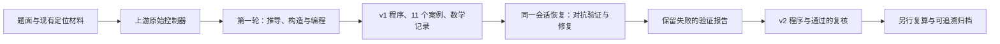

# 用 Creative-Intelligence Agent 研究定位歧义

**徐楷沅 · 2352163 · 2026-10-15**

本研究实际运行了 [Creative-Intelligence Stage 2 的 Mathematical Concept Agent](../../../integrations/creative_intelligence/README.md)。原始 `agent.py` 保持上游字节；由它调用 Codex CLI，并在同一会话中完成 **2 个真实研究单元**。本项目给出问题和参考材料、补写上游快照缺失的两份研究 Skill，并保存调用证据。这里的“两轮”指原控制器接受的两次研究推进，不是模型后端请求数；每轮包含多次工具操作和网络重试。

研究得到了一个可检查的结论：**异步测距中，即使锚点非共线、两条候选轨迹的局部 Jacobian 都满列秩，仍可能无法区分相距 6 m 的两个当前位置。此时任何单点估计都不能同时对两个可行世界保证小于 3 m 的误差。** Agent 写出了有理数精确验证程序，并在第二轮修复了输入解析和文件覆盖问题。

这是对原众包定位开放问题的一个限定数学子问题研究，不是完整工业题的解答，也不主张上述基础事实具有文献首创性。

## 问题与实际贡献

二维恒速轨迹由 θ=(x,v) 表示，观测模型为

$$d_i(\theta)=\|x+t_i v-a_i\|,\qquad |y_i-d_i(\theta)|\le\epsilon_i.$$

这里锚点与时刻精确，ε 是确定性的误差硬界；它不是原统计实验中的标准差 σ。研究区分两个问题：给定实际观测 y，两个候选是否同时可行；以及对指定候选，是否**存在**一个共同观测向量。把后者当作前者会错误报告实际数据的歧义。

| 产物 | 内容与证据 |
|---|---|
| 数学推导 | [research_v1.md](artifacts/research_v1.md)：可行集、反射距离差、近共线充分条件、异步过线反例及 D/2 下界 |
| 精确见证检查器 | [diagnostic_v2.py](artifacts/diagnostic_v2.py)：使用有理数与平方判据，检查给定有限候选，不依赖浮点秩阈值 |
| 构造实验 | [11 个合成案例](artifacts/fixtures_v1.json)、[第一轮结果](artifacts/results_v1.json)：同时保留能找到见证与找不到见证的情况 |
| 验证与修复 | [verification_v2.md](artifacts/verification_v2.md)：独立实现的区间 oracle、坐标变换、反射和边界复核、程序修复 |
| 外部复算 | [第一版复查](post_review/review_v1.json)、[第二版复查](post_review/review_v2.json)：由项目的另一个审阅 Agent 检查实际产物，区别于研究会话的自审 |

检查器输出 `witness` 时提供两个可行候选及位置分离的精确平方值；输出 `no_witness_found` 仅表示在所给候选中未找到见证，不能据此宣告全局唯一、输入可行或定位安全。它尚不自动搜索候选，也不是连续参数空间的完整判定器。

## 一个可以手算的反例

第一轮 Agent 构造了以下非共线例子（`fixtures_v1.json` 的 `noncollinear_crossing_full_rank`）：

- 两条轨迹：θ₁=(0,3,1,1)，θ₂=(0,−3,1,−1)，顺序为当前位置 x 的两维、速度 v 的两维。
- 时刻：−4、−3、−2、−1、0。
- 锚点：(−4,0)、(−3,1)、(−2,0)、(−5/2,0)、(−4,0)。
- 两条轨迹的距离均为：1、1、1、5/2、5，全部 ε=0。

两条轨迹在 t=−3 时都过反射轴，因此该时刻的离轴锚点没有消除镜像歧义。前三锚点的有向二倍面积为 −2，确实不共线。去掉非零距离行缩放后，Jacobian 对应第 0、1、3、4 行的四阶子式分别为 −6、+6，所以两条轨迹处都满列秩 4；当前位置距离仍为 6。由三角不等式，同一估计点到两个候选位置的最大误差至少为 3。

这是对“非共线且局部满秩就足以全局消歧”的反例。它说明需要检查全局候选，而不是宣称全部非共线实例都存在歧义。

## 两轮是如何真实发生的



| 项目 | 第一轮 | 第二轮 |
|---|---|---|
| 上游状态推进 | turn=1，paused | turn=2，complete |
| 任务 | 构造见证、推导条件、编写并运行检查器 | 尝试反驳数学结论、独立实现 oracle、修复工程缺陷 |
| 控制器结果 | [result.json](evidence/turn-001/result.json) | [result.json](evidence/turn-002/result.json) |
| 实际提示 | [prompt.txt](evidence/turn-001/prompt.txt) | [prompt.txt](evidence/turn-002/prompt.txt) |
| 原始 CLI 事件 | [events.raw.jsonl](evidence/turn-001/events.raw.jsonl) | [events.raw.jsonl](evidence/turn-002/events.raw.jsonl) |

两轮 `accepted_structured_research_turn` 均为 true，同一 session ID 可由两份状态与第二轮命令核对。`complete` 只表示题面限定的见证研究完成，不能认证数学正确性。研究会话第二轮属于**同模型自审**；另写 oracle 不等于独立模型确认或形式化证明。

第二轮第一次验证退出 1：[results_v2.json](artifacts/results_v2.json) 原样保留。原因是验证脚本误把镜像子式的符号也写成 −6，以及 Windows 子进程编码处理错误。修正后保留 [第一次通过报告](artifacts/results_pass_v2.json)，补充边界检查后又保存 [最终报告](artifacts/results_final_v2.json)。没有将失败报告改成成功，也没有改写 11 个 v1 科学产物。

确认的 v1 程序缺陷包括重复 JSON 键被静默替换、输出可覆盖输入或已有文件、缺少输入规模限制。v2 拒绝这些情况，并明确限制输入为最多 32 条观测、16 个候选、32768 字节及有限位数的有理数。超界拒绝属于工程支持范围，不是数学结论。

## 无模型复算

只需 Python 3.11+ 标准库，从项目根目录执行：

```text
python -B studies/creative_intelligence/mirror_ambiguity/reproduce_checks.py
```

该入口在临时副本中运行保存的验证程序，将 v1 哈希清单里的本机历史绝对路径重定位到临时副本；不改归档原件，不调用模型。默认输出检查摘要，使用 `--output` 可保存到一个尚不存在的新目录。历史脚本和结果中的 Windows 路径作为来源元数据保留，直接在其他机器运行原 `verify_v2.py` 会遇到这些历史路径，因此应使用此复算入口。

单独运行精确检查器：

```text
python -B studies/creative_intelligence/mirror_ambiguity/artifacts/diagnostic_v2.py studies/creative_intelligence/mirror_ambiguity/artifacts/input_collinear_full_rank_v1.json
```

示例应输出 `witness`、位置分离平方 `36`、误差下界平方 `9`。添加 `--output` 时必须使用新文件，避免覆盖旧证据。非共线例及其他案例由复算入口一并检查。

最终研究会话验证包含每版 517 个实际观测谓词案例和 514 个共同观测谓词案例、11 个原案例及其旋转平移、85 个反射案例、D/2 下界检查、35 次预期状态各不相同的 CLI 调用。另行复查覆盖 9000 个精确算术案例及 v2 的解析、维度和文件保护边界。有限检查没有穷尽所有输入，软件复算也不增加真实研究轮数。

当前便携入口已在本机实际重跑通过 6 组验证与第二版独立回归，原始 70 份文件的摘要保持不变。上游控制器 22 项测试、接入层 18 项测试也均通过；[2026-10-15 检查快照](verification/local_checks.json)保留当时网络受限的状态。2026-10-16 的[整体复核](verification/final_20261016/summary.json)执行 273 项软件测试，271 项通过、2 项因 Windows 符号链接权限跳过，零失败或错误，并再次通过历史审计和数值复算；[独立数学与来源复核](verification/final_20261016/science_review.json)核对了精确反例和上游文件。云端状态必须对应当前提交。默认复算不重跑需要 NumPy 的第一版外部复查，9000 项结果仍是其已归档的历史检查。

## 再次运行参考项目的 Agent

已登录 Codex CLI 后，在项目根目录用新工作目录初始化：

```text
python -B integrations/creative_intelligence/runner.py init --workspace ../creative-mirror-runtime --run-id mirror-study --problem studies/creative_intelligence/mirror_ambiguity/problem.md --materials studies/creative_intelligence/mirror_ambiguity/materials
python -B integrations/creative_intelligence/runner.py advance --workspace ../creative-mirror-runtime --run-id mirror-study
python -B integrations/creative_intelligence/runner.py advance --workspace ../creative-mirror-runtime --run-id mirror-study --prompt-file studies/creative_intelligence/mirror_ambiguity/continuation_002.txt
```

真实模型输出和耗时可能变化；第一轮完成后应检查它的实际产物，再决定是否使用保存的第二轮指令。`materials/environment.txt` 记录原机解释器，移机时应在初始化前制作材料副本并改成自己的可用 Python 路径。研究工作目录须在仓库外，详细运行边界见 [接入说明](../../../integrations/creative_intelligence/README.md)。

## 归档与未完成部分

[SOURCE_MANIFEST.json](SOURCE_MANIFEST.json) 记录 70 份原始材料、研究产物和证据的复制来源与 SHA256；这些文件逐字节复制。`evidence/` 包含初始化、命令、状态、原始事件和错误输出；`snapshots/turn-001/` 保存第二轮前的快照。一次性检查目录未发布，其命令、输出及失败仍在结果 JSON 中。记录含本机路径，不属于匿名化副本。

本目录的 2 个真实研究单元独立于原定位研究的 27 次模型调用、25 个研究动作和 22,052 次定位计算，不能混加。52 页历史论文及冻结实验保留原样。新成果已并入更新后的 [12 页补充 PDF](../../../report/CrowdLocateLab_Quality_Review.pdf)，对应 [LaTeX 源码](../../../latex/quality_addendum.tex)，第 8 页起呈现本次研究。

仍待解决：自动发现候选、完整连续唯一性判定、真实系统误差硬界的标定、锚点和时钟不确定性的处理，以及工业数据验证。本次贡献是可审查的反例、条件推导、有限候选诊断方法和真实迭代记录。
